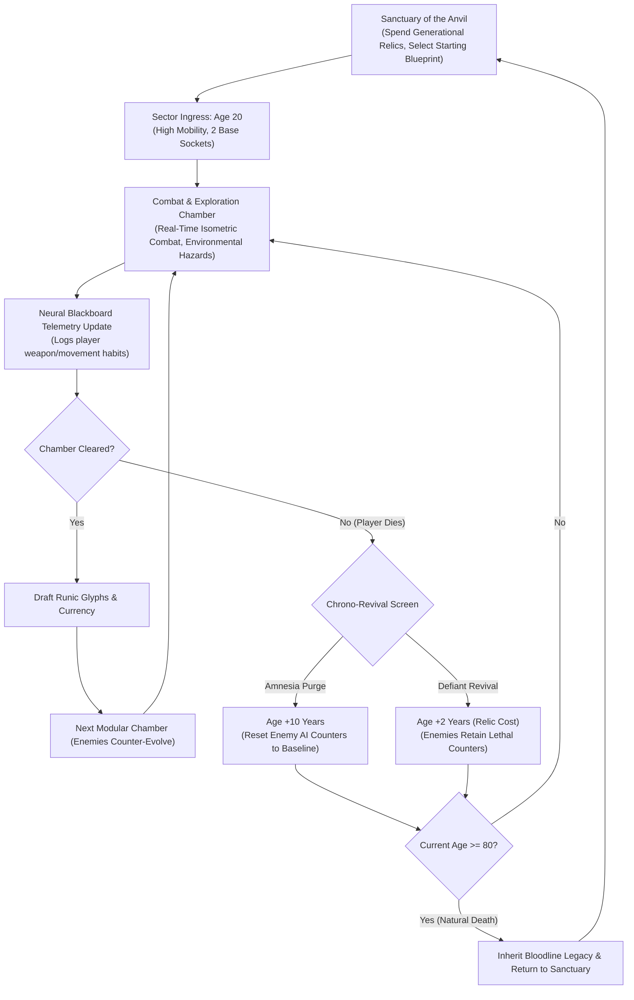

# GDD-01: Executive Summary & High Concept

## 1. High Concept
**Die Old** is a high-octane 2.5D isometric action roguelite where every death costs a decade of your life. Players start at Age 20 navigating an adaptive subterranean megastructure governed by an evolving AI hive mind that tracks your combat habits and mutates to counter them. Each time you fall, you age by 10 years—sacrificing physical resilience for reality-altering eldritch spell mastery. Can you break the cycle and escape before you reach Age 80 and die of old age?

## 2. Core Pillars

| Pillar | Design Goal | Player Feeling |
| :--- | :--- | :--- |
| **I. The Mirror Hive** | Dynamic counter-adaptation driven by a shared AI blackboard. Spamming one weapon or move creates lethal counter-units. | *"The dungeon is studying me. I need to switch my style."* |
| **II. The Samsara Cycle** | Aging upon death (*Sifu*-inspired). Youth provides agility and health; old age provides massive runic sockets and wisdom, but fragility. | *"Do I risk my youth to stay strong, or age to reset their lethal counters?"* |
| **III. Kinetic 2.5D Mastery** | Fast, responsive isometric combat with 360° deflection, wall-slams, and multi-enemy crowd control. | *"I am orchestrating chaos, deflecting projectile storms and smashing foes into pillars."* |
| **IV. Modular Jigsaw Worlds** | Minecraft-style socket-based structure generation using Tiled `.tmx` templates with secrets unlocked by age-gated wisdom. | *"Every sector feels hand-crafted and cohesive, yet entirely unpredictable."* |

## 3. Target Audience & Comparable Titles
- **Primary Audience:** Fans of fast-paced, high-mastery action roguelites (*Hades*, *Dead Cells*, *Curse of the Dead Gods*, *Sifu*).
- **Unique Selling Proposition (USP):**
  1. **Anti-OP Adaptive AI:** Eliminates the "broken build boredom" of traditional roguelikes.
  2. **Age-Driven Stat Morphing:** Player attributes don't just go up; they transform in trade-offs (Health $\leftrightarrow$ Spell Capacity).
  3. **Architectural Jigsaw Assembly:** Levels feel structurally authentic, complete with verticality and environmental hazards.

## 4. The Core Game Loop

