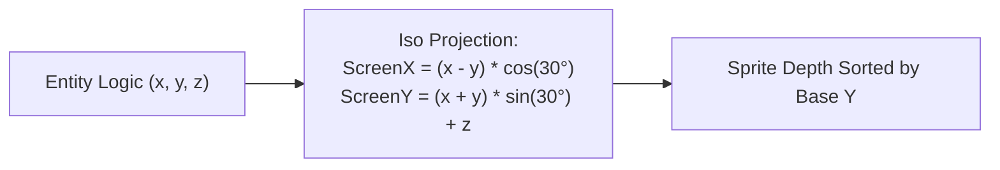
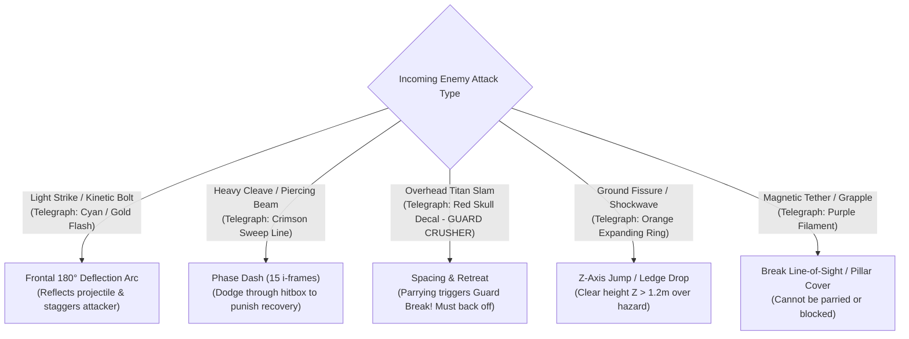
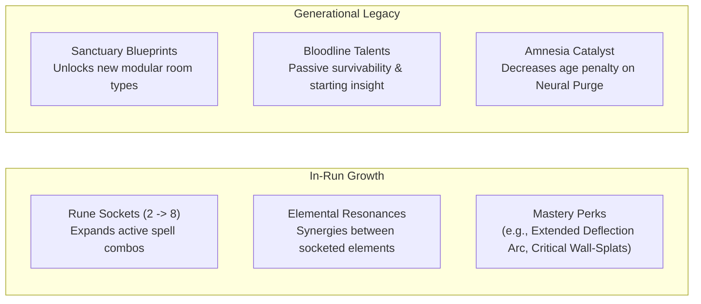

# GDD-02: Combat Systems & Player Mechanics

## 1. Camera Perspective & Visual Depth (2.5D Isometric)

The camera is positioned at a **dimetric 2:1 angle ($30^\circ$ pitch, $45^\circ$ yaw)**, matching the visual depth of *Hades* and *Death's Door*.
- **Depth Layers:** Entities have explicit 3D simulated coordinates `(x, y, z)`.
  - $X, Y$: Ground plane positions (isometric projected to screen).
  - $Z$: Height above ground (used for jump arcs, knockback elevation, falling off ledges, and shadow projection).
- **Y-Sorting:** Sprites dynamically order their rendering depth based on their baseline `y` position to guarantee correct occlusion behind pillars and walls.

---

## 2. Core Movement & Input Schema

The player controls a **Chronos-Weaver** using twin-stick gamepad or Keyboard + Mouse.

| Action | Keyboard / Mouse | Gamepad | Description |
| :--- | :--- | :--- | :--- |
| **Move** | `W`, `A`, `S`, `D` | Left Stick | 360-degree analog omnidirectional movement. |
| **Aim** | Cursor Screen Pos | Right Stick | Independent aim reticle for strikes, parry arc, and projectiles. |
| **Primary Strike** | Left Mouse Button | `X` / Square | Weapon-specific combo chain (e.g. Blade 3-hit, Hammer 2-hit slam). |
| **Deflection Arc** | Right Mouse Button | `Y` / Triangle | 180° directional frontal parry arc aligned to reticle; rear remains vulnerable. |
| **Phase Dash** | Spacebar / Shift | `A` / Cross | Directional dash with 15 frames of i-frames; recovery-cancelable. |
| **Runic Surge** | `Q` / `E` | Right/Left Bumpers | Fires active socketed spells or reality-warping abilities. |

---

## 3. The Defensive Trinity & Attack Taxonomy (Anti-Parry-Spam Architecture)

A core pitfall of action combat is the *"Parry-Everything Syndrome"*, which reduces dynamic 2.5D positioning into a static rhythm game. In *Chronos-Echo*, defense is built on a **Rock-Paper-Scissors Defensive Trinity**:

### 3.1 The 5 Enemy Attack Classes & Counter-Play

| Attack Class | Visual / Audio Telegraph | Parriable? | Dashable (i-frames)? | Proper Counter-Play | Consequence of Wrong Defense |
| :--- | :--- | :--- | :--- | :--- | :--- |
| **Light / Rapid Strike** | Cyan glint + metallic chime (300ms) | **YES** (180° Frontal) | YES | **Parry:** Instantly breaks attacker poise and opens up execution. | Whiffing parry drains 30 stamina; taking hit inflicts minor flinch. |
| **Kinetic Projectile** | Golden aura + bullet tracer | **YES** (180° Frontal) | YES | **Deflect:** Inverts bolt with +150% speed homing back at shooter. | Projectile deals direct HP chip and applies elemental status. |
| **Guard-Crusher (Heavy Slam)** | Red Skull Icon + 700ms overhead wind-up | **NO** (Guard Break!) | YES (Tight window) | **Spacing / Bait & Punish:** Step out of range, then dash in during 600ms recovery. | **Trying to parry causes Guard Break:** Player stunned for 1.2s and takes +100% damage! |
| **Ground Area Hazard / Shockwave** | Orange circular decal expanding on floor | **NO** | NO (Full linger) | **Z-Axis Jump:** Elevate height $z > 1.2m$ or vault onto raised elevation ledge. | Player knocked down and launched into air. |
| **Magnetic Grapple / Tether** | Purple targeting ray + high-pitch whine | **NO** | YES (Break tether) | **Line-of-Sight Break:** Duck behind pillars or break distance past 8m. | Player reeled across the room into point-blank hazard. |

### 3.2 2.5D Isometric Spatial Mechanics & Depth Perception
In a 2:1 dimetric perspective ($30^\circ$ pitch), judging vertical height $Z$ is deceptively difficult. *Chronos-Echo* implements strict visual clarity anchors:
1. **The Ground Shadow Anchor:** All entities (player, flying automata, airborne projectiles, jumping bosses) project a crisp **dark elliptical drop shadow directly on the $(X, Y)$ ground plane**. The shadow indicates the true physical collision footprint, eliminating air-whiffs.
2. **Elevation Advantage (High Ground):** Striking an enemy from an elevated ledge ($z > 1.5m$) adds **+50% knockback momentum and crushing poise damage**, incentivizing players to use vertical terrain.
3. **Friendly Fire & Collisional Meatshields:**
   - Enemy projectiles **collide with other enemies**! A player can position themselves so an Aethel-Arbalest sniper bolt hits an advancing Clockwork Myrmidon in the back.
   - Knocking an enemy with heavy knockback into another enemy triggers **Billiard Ball Collision Damage**, staggering both units.

---

## 4. Wall-Slam & Impact Physics

Damage is heavily tied to spatial positioning rather than basic weapon stat numbers:
- **Knockback Vectors:** Heavy attacks and successful parry pulses impart strong linear momentum.
- **Wall-Slam Impact:** If an enemy collides with a solid environment wall or pillar while in knockback:
  - Takes **Collisional Crushing Damage** proportional to remaining momentum.
  - Suffers a 0.8-second wall-splat stun.
  - Can trigger environmental chain reactions (e.g., smashing a guardian into an explosive fuel urn or electrified pylon).

---

## 5. Player Leveling & Power Scaling

To maintain anti-OP integrity and prevent power-creep trivialization, player growth is structured around **Horizontal Synergy & Runic Capacity** rather than linear damage inflation:

### Progression Systems:
1. **In-Run Runic Matrix:** Players collect runes with distinct properties:
   - *Core Elements:* Spark, Frost, Cinder, Acid.
   - *Modifiers:* Fork, Orbit, Chain, Pierce, Impact-Detonate.
   - Slots scale with **Age**: You cannot unlock 8-rune game-breaking god-builds in your 20s. You must reach elder years (with lower HP) to wield high-tier spell combinations.
2. **The Posture / Poise Gauge:** Both the player and enemies possess a Poise bar under their HP. Breaking enemy poise with heavy strikes or parries opens them up to instant Execution Finishers that drop high-value Chrono-Shards.

---

## 6. The 4 Starting Weapon Archetypes

Players select their initial weapon catalyst in the Sanctuary of the Anvil before descending:

| Weapon Archetype | Kinetic Profile | Combo Sequence | Wall-Slam Synergy | Ideal Playstyle |
| :--- | :--- | :--- | :--- | :--- |
| **Chronos Blade** | Balanced medium-reach slashing weapon | 3-hit slash (Horizontal Cleave $\rightarrow$ Thrust $\rightarrow$ Overhead) | Moderate knockback on 3rd strike | Fluid skirmishing, reliable recovery cancels, versatile parry weaving. |
| **Aethel Great-Hammer** | High poise, slow crushing kinetic weight | 2-hit slam (Heavy Sweep $\rightarrow$ Ground-Fissure Impact) | Extreme radial knockback; smashes through barriers | Spatial crowd-crushing, punishing poise breaks, high risk/reward. |
| **Twin Rift Daggers** | Rapid hyper-mobile flurry strikes | 4-hit rapid thrust loop with mini-lunges | Low knockback, but pin-point directional shove | High-APM dodging, rapid elemental status buildup, precision backstabs. |
| **Energy Arbalest** | Piercing ranged projectile catalyst | 2-stage firing (Rapid Light Bolt $\rightarrow$ Charged Piercing Beam) | Charged shots propel enemies backward into walls | Tactical spacing, sniper line-of-sight play, deflection baiting. |

---

## 7. Weapon Special Techniques & Proc Coefficients (Balancing Runic Synergies)

### 7.1 Weapon Special Attacks (Secondary Actions)
In addition to the primary combo, every weapon possesses a dedicated **Special Action** (triggered via `R` / Right Bumper):
- **Chronos Blade — *Temporal Riposte Lunge*:** A 6-meter piercing lunge that penetrates through enemy ranks and leaves an after-image trail that detonates socketed trigger runes.
- **Aethel Great-Hammer — *Ground Quake Shock*:** Smashes the hammer into the ground, raising an earthen shockwave that launches all enemies within 3 meters into the air ($Z > 1.5m$).
- **Twin Rift Daggers — *Shadow Step Ambush*:** Instantly teleports directly behind the targeted enemy in a puff of purple smoke, resetting the player's recovery lag.
- **Energy Arbalest — *Ricochet Salvo*:** Fires 3 energy bolts that bounce off walls and stone pillars up to 2 times, searching for targets.

### 7.2 Proc Coefficients (Preventing Fast Weapon Exploit)
If socketed runes triggered $100\%$ on every hit, ultra-fast weapons (Twin Daggers hitting 5 times/sec) would deal $5\times$ more elemental spell damage than the slow Great-Hammer. *Chronos-Echo* enforces strict **Weapon Proc Coefficients**:

| Weapon | Attack Speed | Proc Coefficient | Elemental Payload Multiplier | Balancing Effect |
| :--- | :--- | :--- | :--- | :--- |
| **Twin Rift Daggers** | 5.0 hits / sec | **0.35** (Internal Cooldown: 0.15s) | $0.6\times$ base payload | High status build-up frequency, but smaller individual spell bursts. |
| **Chronos Blade** | 2.2 hits / sec | **1.00** (Standard) | $1.0\times$ base payload | Clean 1:1 trigger consistency. |
| **Aethel Great-Hammer** | 0.9 hits / sec | **1.50** (Guaranteed trigger) | **$2.5\times$ amplified payload** | Every heavy slam unleashes a catastrophic elemental detonation. |
| **Energy Arbalest** | 1.4 / 0.5 (Charged) | **0.50** (Light) / **2.00** (Charged) | $0.7\times$ (Light) / **$2.0\times$ (Charged)** | Rewarding precision aim and charge commitment. |

---

## 8. Status Effect Diminishing Returns & On-the-Spot Revival

### 8.1 Crowd-Control Diminishing Returns (No Perma-Freeze Exploit)
To prevent players from permanently locking bosses or elite champions in freeze or stun states:
- **First Freeze:** Full 2.0-second frozen duration.
- **Second Freeze (within 10s):** 1.0-second frozen duration.
- **Third Freeze:** Target gains **Cryo-Poise (Complete Freeze Immunity) for 6.0 seconds**, though they still take thermal shock damage from Fire.

### 8.2 Sifu-Style On-The-Spot Revival Mechanics
When the player takes fatal damage:
1. Time dilates into a sepia chromatic aberration; the Chrono-Pendant manifests.
2. The player chooses **Amnesia Purge (+10 Years)** or **Defiant Revival (+2 Years + 100 Shards)**.
3. The character revives **immediately on the spot** (no jarring room reload or screen fade).
4. Revival emits an **Atmospheric Kinetic Shockwave** pushing all surrounding enemies back by 5 meters and grants **2.0 seconds of invulnerability (i-frames)** so the player can reposition immediately.
5. Bosses and automata **retain their current damage and phase state**.

