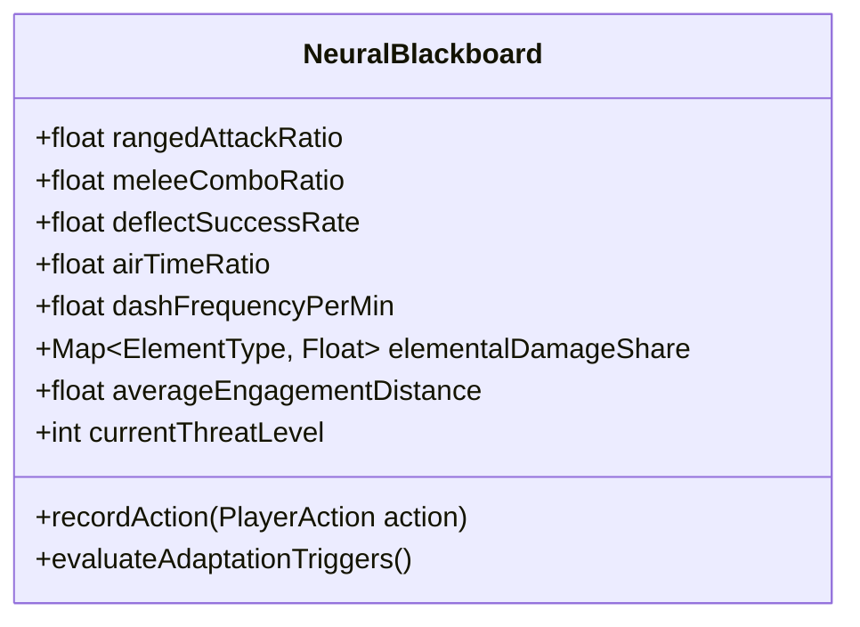
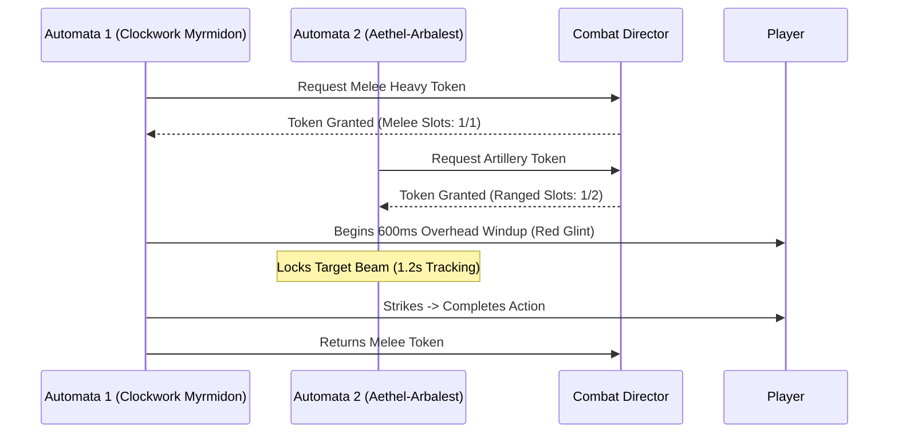
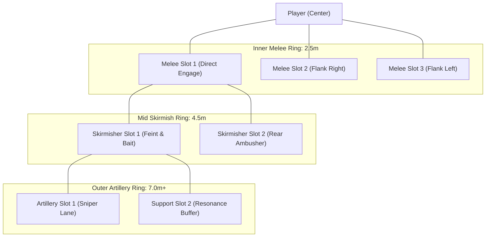

# GDD-03: Neural AI Adaptation & Counter-Evolution

## 1. Overview & Architectural Purpose

The core design failure of most roguelites is the **"Optimal Build Degeneracy"**: once a player discovers an overpowered combination (e.g., kiting with a homing flame projectile), they execute that same strategy for 50 hours until the game becomes trivial.

In **Chronos-Echo**, the dungeon is governed by an entity called **The Overseer Core**. The Overseer actively monitors player combat telemetry and mutates enemy squads to systematically dismantle the player's current comfort zone.

---

## 2. Telemetry Metrics Tracked by the Shared Blackboard

Every frame, the `TelemetrySystem` samples player actions into a rolling **60-second window**:

### Telemetry Trackers:
1. **Engagement Distance (`avgDistance`):** Average distance (meters) between player and target when dealing damage.
   - $> 6.0m$ = Kiting / Ranged archetype.
   - $< 2.5m$ = Melee aggressive rusher.
2. **Deflection Mastery (`deflectRate`):** Percentage of enemy attacks neutralized via Deflection Pulse.
3. **Dash Dependency (`dashFreq`):** Number of phase dashes executed per 30 seconds.
4. **Elemental Dominance (`elementShare`):** Proportion of damage dealt by Fire, Frost, Shock, or Acid.
5. **Clear Velocity (`roomClearTime`):** Speed at which combat encounters are wiped.

---

## 3. Dynamic Adaptation & Mutation Triggers (Telegraphed Evolution)

To prevent the "Moving Goalposts" frustration trap, the Overseer **never introduces sudden silent immunities**. Instead:
1. **Pre-Chamber Warnings:** Evolution triggers are telegraphed on holographic airlock gates before entering the next wing (e.g., *"Overseer Alert: Kinetic Dampeners Deployed"*).
2. **Tactical Vulnerabilities:** Counter-units always possess an organic counter-tactic (e.g. Shields break from wall-slams; Thermal Plating shatters upon Cryo freezing).

| Detected Player Pattern | Threshold | Overseer Mutation Response | Counter-Play Weakness | Visual / Audio Cue |
| :--- | :--- | :--- | :--- | :--- |
| **Projectile Kiting / Sniper** | `rangedRatio > 0.65` | **Kinetic Aegis Vanguards:** Automata deploy frontal directional energy shields. | Flank rear or wall-slam into shield to overload it. | Blue holographic shield flare & hum on spawn. |
| **Hyper-Aggressive Melee Rush** | `meleeRatio > 0.70` | **Reactive Barbed Poise:** Automata enter fortified defensive stances reflecting direct hits. | Break posture with heavy weapon strikes or bait deflect. | Red sparking spikes extend from armor plating. |
| **Deflection Spam** | `deflectRate > 0.60` | **Ground Shockwave Fissures & Beams:** Automata switch to unparriable continuous ground hazards. | Must be jumped or dashed over; cannot be parried. | Orange geometric floor decals & laser charge whine. |
| **Dash / i-Frame Abuse** | `dashFreq > 20/min` | **Stasis Web Anchors:** Enemies deploy tether mines that temporarily disable dashing. | Destroy mines with ranged hits or deflect shockwaves. | Purple filament webs spanning between pillars. |
| **Single-Element Dominance** | `elementShare > 0.50` | **Adaptive Thermal/Cryo/Galvanic Sinks:** Absorbs targeted element to charge a counter-battery. | Overload opposite element to trigger severe Thermal Shock. | Elemental sink valves venting glowing steam. |

---

## 4. The Combat Director & Attack Token System

To guarantee combat remains readable, theatrical, and fair—rather than an uncontrollable mob gang-bang—all enemies are governed by a centralized **Combat Director**:

### Attack Token Concurrency Rules:
- **Max Active Melee Attacks:** 1 Heavy or 2 Light strikes concurrently.
- **Max Active Ranged Attacks:** 2 Projectile salvos concurrently.
- **Support / Flanker Behaviors:** Enemies waiting for an attack token circle, feint, position for flanking angles, or channel non-damaging buffs.
- **Telegraph Hierarchy:** All high-damage attacks must provide at least **400–600ms visual and auditory wind-up warnings** before the active hitbox becomes lethal.

---

## 5. Squad Formations, Ring Slots & Inter-Enemy Synergies

Enemies do not swarm into a chaotic overlapping clump. Instead, they organize into structured **Concentric Spatial Rings**:

### 1. Inter-Enemy Combo Behaviors:
- **The Vanguard Phalanx:** Kinetic Aegis Vanguards form an impassable frontal wall with their directional shields. Aethel-Arbalests position directly behind them, firing safe piercing bolts through the shield slits.
  - *Player Solution:* Vault over with a $Z$-axis jump or wall-slam a flanker into the shield from behind.
- **The Web & Crush Combo:** Phase Stalkers deploy stasis tethers to root the player's dashing capabilities, immediately signaling Clockwork Myrmidons to charge their unparriable overhead Guard-Crusher.
- **Chemical Chain Reactions:** Slag Conduits vent volatile oil mist across a sector. If an Arbalest's fiery kinetic bolt flies through the cloud, the entire corridor explodes in a massive firestorm that damages both the player and caught automata.

### 2. Tactical Friendly Fire & Meatshields:
- **Line-of-Fire Blocking:** Enemies respect line of sight. If an ally is directly in the path of an Arbalest, the sniper must reposition or risk hitting their own ally.
- **Weaponized Friendly Fire:** Clever players can deliberately bait snipers into killing their own swarm units or knocking fragile Stalkers into wall-splat stuns.

