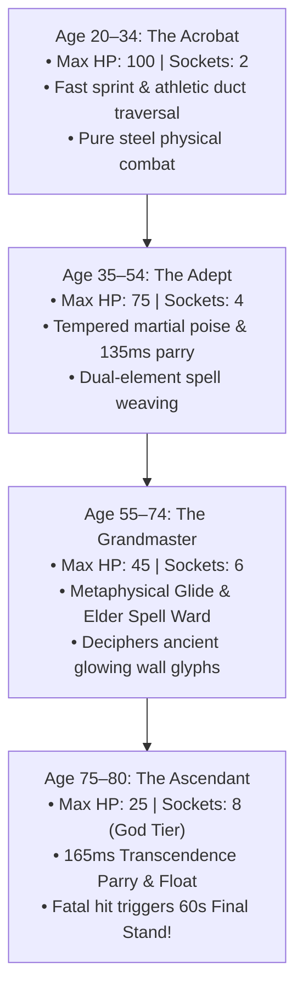
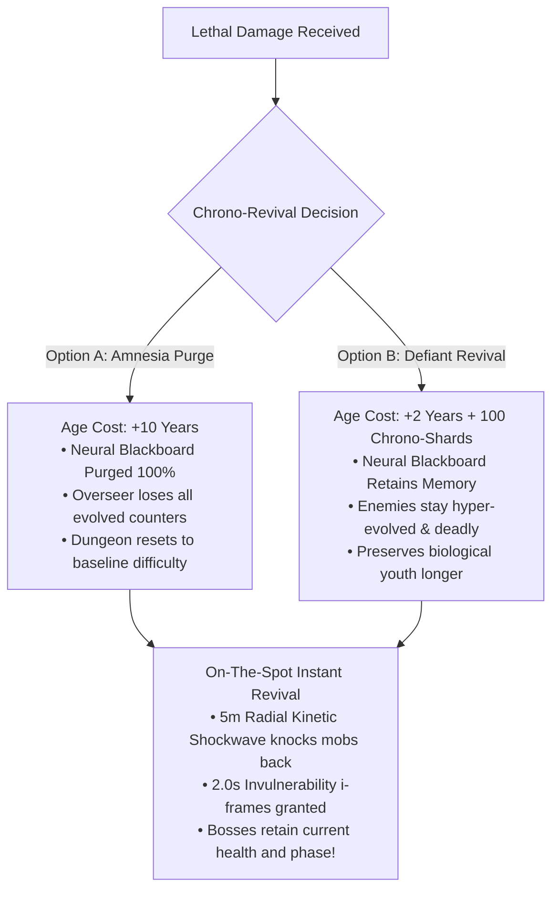
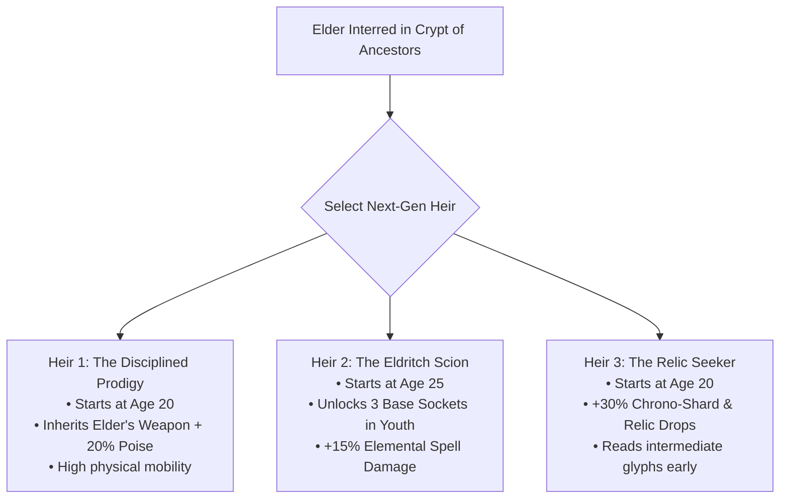

# GDD-04: The Samsara Aging & Generational Inheritance System

## 1. Overview of the Aging Mechanic
In **Die Old**, death is not a binary game over; it is a **chronological transaction**. Powered by the ancient **Aethelgard Chrono-Pendant**, falling in battle rewinds the fatal blow by draining biological lifespan from the wielder.

The player begins their descent at **Age 20** in the physical prime of their youth. Each revival or voluntary Chrono-Pact advances the character's chronological age, radically morphing their core attributes, mobility, visual appearance, audio soundscape, and supernatural capacity.

---

## 2. The Four Life Stages & Mortal Metamorphosis

### Detailed Attribute & Metamorphosis Matrix

| Attribute / Life Stage | Age 20–34 (The Acrobat) | Age 35–54 (The Adept) | Age 55–74 (The Grandmaster) | Age 75+ (The Ascendant) |
| :--- | :--- | :--- | :--- | :--- |
| **Max Health** | **100 HP** | **75 HP** | **45 HP** | **25 HP** (Glass Cannon) |
| **Mobility Mode** | High-speed physical sprint | Standard run | **Metaphysical Glide** (Mana hover) | **Celestial Levitation** (Zero friction) |
| **Dash Cooldown** | 1.0s recharge | 1.2s recharge | 1.4s recharge | 1.5s recharge |
| **Runic Sockets** | **2 Sockets** | **4 Sockets** | **6 Sockets** | **8 Sockets** (Reality-Bending God Tier) |
| **180° Deflection Window** | 120ms (7 frames) | 135ms (+Insight) | 150ms (+Mastery) | **165ms** (+Transcendence) |
| **Elder Spell Ward** | None | None | **Absorbs 1 fatal hit every 45s** | **Absorbs 1 fatal hit every 30s** |
| **Visual Appearance** | Athletic stance, brown/black hair, clean steel weapon. | Martial poise, graying temples, etched runic arm scars. | Silver hair, embroidered elder robes, glowing runic eyes. | Spectral phantom body hovering 10cm off floor, golden aura. |
| **Audio Soundscape** | Quick rhythmic footsteps, lively vocal exertion grunts. | Calm measured breathing, resonant weapon clangs. | Raspy stoic breathing, deep ancient chime soundscapes. | Ethereal harmonic hum, whispering chronos voices. |
| **Sensory Perception** | Crawls through narrow collapsed ventilation ducts for secret loot. | Detects trap mechanisms and early hazard alerts. | Deciphers ancient glowing wall glyphs hidden to young eyes. | **Full Resonance:** Walks through secret phase doors in stone walls. |

---

## 3. The Death Dilemma: Purge vs. Defiance

When taking fatal damage before Age 80, time freezes in chromatic sepia, and the Chrono-Pendant interface manifests:

---

## 4. The Age 80 Final Stand & Interment Ceremony

When an Ascendant elder reaches **Age 80** and suffers a fatal blow, death does **NOT** cut to black immediately:

### 1. The 60-Second Final Stand (Transcendence Overload):
- The Chrono-Pendant shatters into blazing golden fragments.
- For **60 seconds**, the elder enters an invincible god-state:
  - Invulnerable to all damage.
  - All runic spell cooldowns reduced by **75%**.
  - All 8 rune sockets trigger in catastrophic, screen-clearing cascades!
- The player has 60 seconds of unbridled godhood to slay the boss or clear the chamber before their physical body peacefully dissolves into golden stardust.

### 2. The Crypt of Ancestors (The Interment):
- The camera transitions to the **Crypt of Ancestors** in the Sanctuary of the Anvil.
- A permanent stone sarcophagus is carved into the wall, recording:
  - *Ancestor Epitaph:* (e.g. *"Arch-Weaver Eldrid, Smelter of Titans"*).
  - *Accomplishments:* Final depth reached, total kills, and cause of natural death.
  - *Master Rune Scribed:* The specific rune they mastered is engraved on their tomb.

---

## 5. Generational Succession & The 3 Heirs

Once the elder is interred, the legacy passes to the next generation. At the Sanctuary of the Anvil, the player chooses their **Next-Gen Apprentice from 3 Distinct Heirs**:

### The 4 Pillars of Inheritance:
1. **The Ancestral Heirloom (Rune Inheritance):** The player selects **1 Master Rune** from the deceased elder's build. The chosen apprentice starts their new life cycle with that rune already socketed in their starting catalyst!
2. **Permanent Blueprint Archive (Hall of Architects):** All unlocked Tiled prefab room templates, puzzle shortcuts, and secret vaults permanently remain in the procedural jigsaw generator pool forever.
3. **The Bloodline Altar:** All permanent stat upgrades invested with Aethelgard Relics (Max HP, Poise Resistance, Stamina Recovery) apply to all future descendants.
4. **The Overseer Amnesia Reset:** The new young apprentice faces an Overseer Hive Mind whose memory banks are **reset to baseline**. The machine has no memory of the previous elder's playstyle, giving the new apprentice a fresh tactical runway to forge their own combat identity.

---

## 6. Voluntary Chrono-Wells (Aging as a Tactical Choice)

To prevent skilled players who never die from being locked out of the elder 6-to-8 socket god-builds, hidden chambers feature **Voluntary Chrono-Wells**:
- **The Pact of Chronos:** The player voluntarily drinks from the well, advancing their age by **+10 Years** without suffering a death count.
- **The Eldritch Boon:** Instantly unlocks +2 Runic Sockets, grants 1 Master Runic Glyph, and restores all HP to the new life stage maximum.
- **Strategic Player Agency:** High-skill players can intentionally transition from a high-mobility Youth brawler into an ultra-destructive Elder spell-caster to tackle brutal late-game depths!

