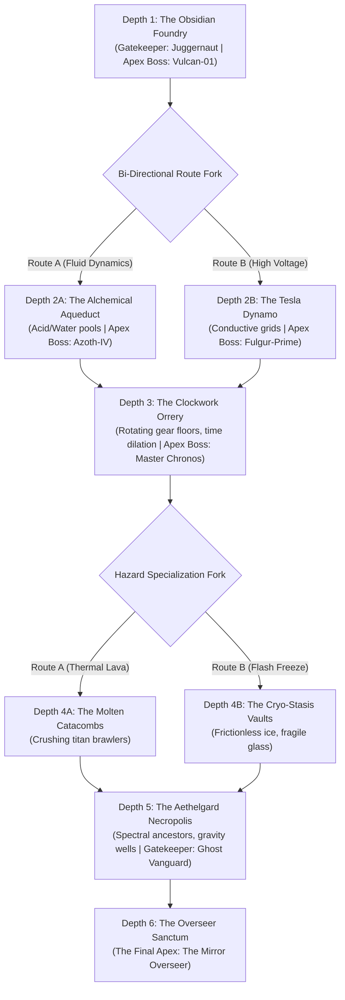
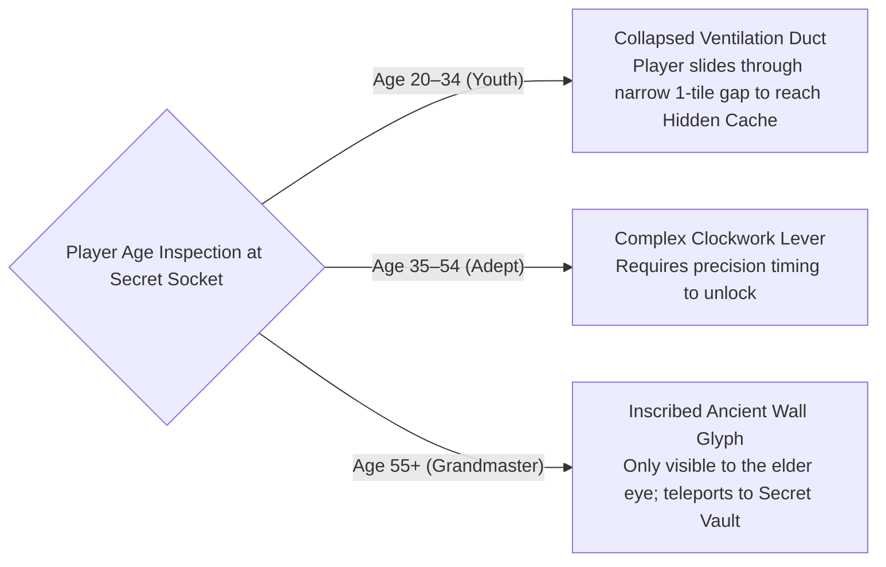

# GDD-05: Procedural Structure Generation (Modular Jigsaw)

## 1. Architectural Philosophy: The 6-Depth Directed Run Graph

A linear 4-stage game is too brief for an authentic roguelite—it fails to provide enough attrition for players to die, age, build-craft, or experience escalating difficulty. *Chronos-Echo* structures each descent as a **Deep Directed Graph of 6 Depth Tiers with Branching Biomes** (35 to 45 total chambers per run, lasting 45–60 minutes):

### Sector Internal Pacing (The Hybrid Gauntlet Anatomy):
Every Depth Tier is generated using hand-crafted modular Tiled prefabs with rigid grammatical pacing:
`[Ingress Hub] -> [Wing 1: Puzzle Exploration] -> [Lockdown Arena 1] -> [Wing 2: Age-Gated Secrets] -> [Gatekeeper Mini-Boss Vault] -> [Sanctuary Rest Airlock / Shop] -> [Wing 3: Hazard Gauntlet] -> [Pre-Boss Antechamber] -> [Sector Apex Boss Sanctum]`.

---

## 2. Structured Randomness: How Levels, Enemies & Bosses Spawn

True roguelite replayability comes from **Randomness with Rigid Architectural Structure**—preventing both predictable repetition and chaotic, unplayable garbage.

### 1. Stage Randomness (Grammar & Jigsaw Matching):
- Each room is selected from a pool of **80+ hand-authored Tiled `.tmx` templates**.
- Socket connection rules enforce architectural cohesion (e.g. `Corridor_North` only connects to `Door_South`).
- Headless A* connectivity validators guarantee that every key, puzzle lever, and boss gate is 100% reachable with zero soft-locks.

### 2. Enemy Spawning Randomness (The Threat Budget & Role Quotas):
Enemies are **never spawned randomly**. Each combat room has an **Encounter Threat Budget** (e.g. 100 pts in Depth 1, scaling to 350 pts in Depth 6). The Combat Director distributes this budget across strict **Role Quotas**:
- **40% Fodder / Swarm:** Chrono-Mites (cleave targets).
- **30% Bruisers:** Clockwork Myrmidons (spatial wall-slam targets).
- **20% Artillery:** Aethel-Arbalests (line-of-sight snipers).
- **10% Skirmishers:** Phase Stalkers (rear flankers).
*Overseer Influence:* The Director swaps basic enemy variants for counter-mutations (e.g. adding Kinetic Shields) based on the Blackboard's telegraphed telemetry.

### 3. Boss Randomness with Structural Identity:
- **Fixed Core Identity:** The Apex Boss of a sector has a distinct thematic personality and arena.
- **Randomized Secondary Arsenal:** Bosses spawn with 1 of 3 secondary loadouts (e.g. Vulcan-01 can spawn with Molten Flak, Magnetic Harpoons, or Steam Jets).
- **Gatekeeper Mini-Boss Pool:** Drawn randomly from a pool of 3 candidate champions per depth tier.
- **In-Fight Adaptive Mutation:** The boss's Phase 2 moveset mutates in real-time based on your Phase 1 combat habits!

---

## 2. Jigsaw Socket Specification & Metadata

Rooms are authored in **Tiled Map Editor** (`.tmx` format) with standardized tile layers and an `Object Layer` named `JigsawSockets`.

### Socket Object Attributes in Tiled:
- `socket_id`: String (e.g., `arch_east_01`)
- `socket_type`: String enum (`CORRIDOR_E`, `CORRIDOR_W`, `CORRIDOR_N`, `CORRIDOR_S`, `SHAFT_DOWN`, `VAULT_DOOR`)
- `target_pool`: String (`combat_rooms`, `puzzle_vaults`, `hazard_conduits`, `shop_sanctuaries`)
- `required_clearance`: Rectangular bounding box $(w \times h)$

---

## 3. Tiled Map Layer Conventions

To ensure seamless stitching into the global LibGDX isometric world, every room template adheres to this strict layer hierarchy:

| Layer Name | Type | Purpose | Render / Physics Behavior |
| :--- | :--- | :--- | :--- |
| `Terrain_Floor` | Tile Layer | Ground stone tiles, grates, dirt paths | Rendered under all entities |
| `Terrain_Elevation` | Tile Layer | Cliffs, raised walkways, stairs | Affects entity simulated $Z$-height |
| `Terrain_Walls` | Tile Layer | Solid perimeter walls, pillars, archways | Generates static Box2D collision bodies |
| `Dynamic_Hazards` | Tile Layer | Spikes, lava fissures, acid pools | Cellular damage & elemental triggers |
| `JigsawSockets` | Object Layer | Door sockets, connection points | Consumed during level generation |
| `EntitySpawns` | Object Layer | Automata spawns, chest pedestals, urns | Spawns Ashley ECS entities on room enter |
| `AgeGatedSecrets` | Object Layer | Youth crawlspaces, Elder glyph doors | Conditionally activated based on player age |

---

## 4. Age-Gated Structural Secrets

Every generated sector includes 2–3 branch chambers accessible only through age-specific mechanics:

### Gameplay Impact:
- A run as a young character allows high-speed exploration through athletic shortcuts.
- A run as an elder character reveals hidden metaphysical secrets and forbidden runes etched into the ancient stone walls that young players cannot even see.
