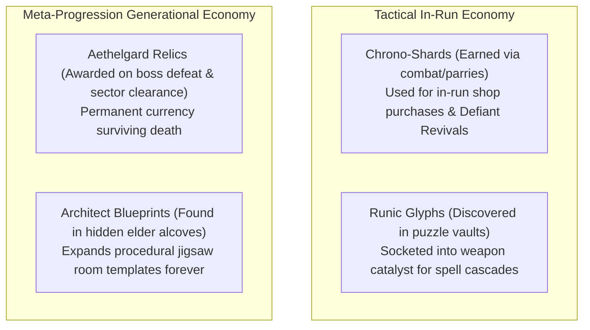
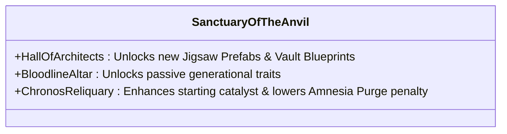

# GDD-06: Progression Systems & Economy

## 1. Dual-Loop Economy Model

*Chronos-Echo* separates short-term tactical improvisation from long-term bloodline growth:



---

## 2. In-Run Spell Crafting (The Runic Socket Pipeline)

Your primary weapon catalyst contains sockets that expand as you age (2 in Youth, 4 in Adulthood, 6 in Grandmaster, 8 in Ascendant). Runes snap into 3 functional categories:

```
[ TRIGGER RUNE ]  --->  [ FORM / MODIFIER RUNE ]  --->  [ ELEMENTAL PAYLOAD RUNE ]
```

### Runic Categories & Components:
1. **Trigger Runes:**
   - *On-Impact:* Activates payload when primary melee/ranged strike connects.
   - *On-Deflect:* Activates radial spell burst when a projectile is successfully parried.
   - *On-WallSlam:* Detonates when an enemy collides with a wall under knockback.
2. **Form / Modifier Runes:**
   - *Split-Helix:* Duplicates payload into 2 weaving projectile streams.
   - *Static-Mine:* Leaves payload anchored to ground as an armed proximity trap.
   - *Chain-Surge:* Payload arcs between up to 4 nearby enemies.
3. **Elemental Payload Runes:**
   - *Fulminant Spark:* Deals shock damage and electrifies puddles/metals.
   - *Cryo Gel:* Freezes fluids, creates slippery low-friction patches, and chills armor.
   - *Pyric Flame:* Ignites oil, combusts toxic gas, and melts frozen obstacles.
   - *Caustic Slime:* Dissolves armor poise and creates corrosive damage puddles.

### Emergent Chemistry & Surface Interactions:

The dungeon floors feature active fluid dynamics (Water, Oil, Acid, Molten Slag) that react to player and enemy elemental spells:

| Trigger Element | Surface / Target Element | Chemical Reaction | Physical Gameplay Impact |
| :--- | :--- | :--- | :--- |
| **Pyric Flame** | **Cryo Gel / Ice** | **Thermal Shock** | Instantly shatters frozen targets, dealing 200% damage and releasing a vision-obscuring steam cloud. |
| **Pyric Flame** | **Oil Puddle / Gas** | **Deflagration Blast** | Ignites entire fluid surface into persistent flames; burns standing entities. |
| **Fulminant Spark** | **Water / Conductive Pool** | **Hydro-Electric Arc** | Electrifies fluid body; all entities in pool suffer 1.0s shock stun. |
| **Cryo Gel** | **Water Puddle** | **Flash Freeze** | Freezes liquid into frictionless ice; enemies sliding into walls take +100% wall-slam crushing damage. |
| **Fulminant Spark** | **Caustic Slime / Acid** | **Galvanic Burst** | Detonates acid pool into corrosive mist that completely strips enemy poise armor. |

---

## 3. The Sanctuary Archive (Meta-Progression)

When an 80-year-old elder dies, their soul is interred at the **Sanctuary of the Anvil**. Players spend accumulated **Aethelgard Relics** at three distinct shrines before sending their young apprentice into the megastructure:



### 1. Hall of Architects (World Expansion):
- *Flooded Vaults Blueprint (50 Relics):* Injects 8 new water/drain puzzle rooms into the dungeon generator.
- *Tesla Spire Blueprint (80 Relics):* Adds high-voltage lightning rooms with conductive environmental hazards.

### 2. Bloodline Altar (Inherited Traits):
- *Ancestral Poise:* +20% base poise resistance for all future descendants.
- *Elder Insight:* Apprentice starts with the ability to read intermediate glyphs at Age 40 instead of Age 55.

### 3. Chronos Reliquary (Life Preservation):
- *Stabilized Pendant:* Reduces the age penalty of an Amnesia Purge from +10 years down to +7 years.
