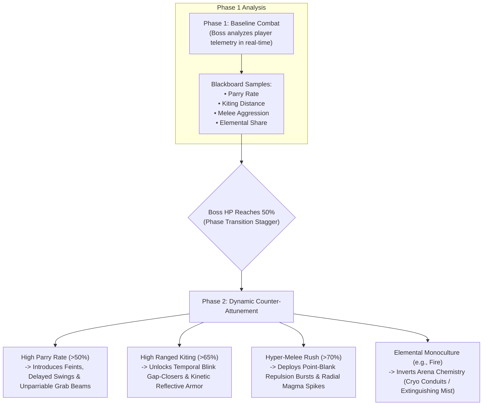
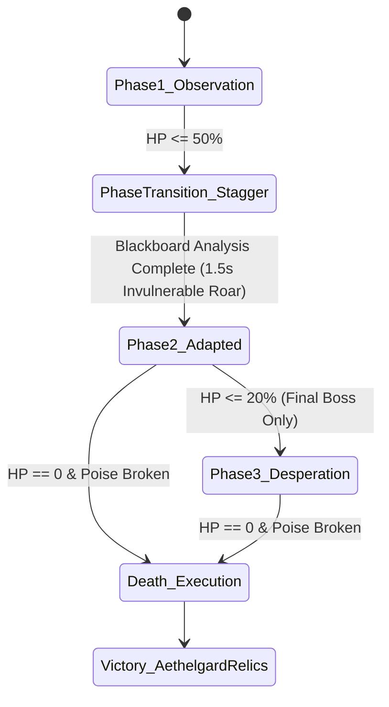

# GDD-07: Boss Encounters & Real-Time Adaptive Mastery

## 1. Boss Design Philosophy

In *Chronos-Echo*, bosses are not bullet sponges or stat checks. They are the **apex sentinels of the Overseer Hive Mind**. A great boss encounter tests the player's entire mechanical repertoire: spatial positioning, parry timing, dash discipline, wall-slam usage, and elemental chemistry.

Most importantly, **bosses actively learn from the player**:
- **In-Fight Phase Adaptation:** If the player relies on a specific tactic in Phase 1, the boss alters their moveset, rhythm, and counters in Phase 2.
- **Generational Memory:** If a player dies to a boss and returns in a new life stage (e.g., from Age 20 to Age 30 or 50), the boss acknowledges their aging and retains telemetry on how the player fought in previous encounters.
- **Auditory & Visual Telegraphs:** Following the golden rule of Game AI design, bosses verbally and visually declare their adaptations so the player feels tested rather than cheated.

---

## 2. Real-Time Boss Adaptation Matrix

---

## 3. The 4 Sector Boss Roster

### Sector I Boss: The Smelting Titan (Vulcan-01)
> *"You burn with youthful insolence, Weaver. Let us temper you in slag."*

- **Arena:** *The Crucible Pit* — Surrounded by lava channels with 4 destructible bronze cooling pillars.
- **Archetype:** Colossal Clockwork Brawler & Molten Engine.
- **Poise & HP:** 800 HP / 250 Poise (Heavy poise armor).

#### Moveset & Telegraphs:
1. **Foundry Cleave (Parriable):** 2-hit horizontal sweep with a glowing crucible ladle. Telegraph: ladle scrapes the floor with bright sparks (500ms).
2. **Crucible Slam (Unparriable):** Leaps into the air and smashes down, sending molten shockwaves outward. Telegraph: orange circular danger decal expanding for 800ms.
3. **Slag Salvo (Deflectable):** Fires 5 lobbed burning projectiles. Can be reflected back with the 180° Deflection Arc to break the Titan's poise.

#### Dynamic Real-Time Adaptation (Phase 2 at 50% HP):
- **Parry Master Detected:** Titan begins **feinting**—raising the ladle, holding it for an extra 250ms with a fake audio clang, then executing a crushing unparriable grab.
- **Kiter Detected:** Fires a magnetic harpoon that anchors to the player and reels them across the lava channel.
- **Pillar Destruction:** Knocking the Titan into bronze cooling pillars causes them to collapse, dousing the Titan in liquid coolant for a **10-second Cryo-Vulnerability Window**.

---

### Sector II Boss: The Chimera Alchemist (Azoth-IV)
> *"Your blood grows thicker with the decades... let us see how it reacts to acid."*

- **Arena:** *The Flooded Sluice* — Four dynamic valve pipes that cycle water, oil, and acid across the floor.
- **Archetype:** Multi-Limbed Alchemical Automaton manipulating Emergent Chemistry.
- **Poise & HP:** 650 HP / 180 Poise.

#### Moveset & Telegraphs:
1. **Caustic Spray:** Sweeps a continuous stream of acid across a 90° arc. Dissolves player poise; must be jumped or dash-dodged.
2. **Cryo-Lance Thrust (Parriable):** Rapid piercing thrust with an iced needle. Telegraph: high-pitched ice-crystal chime (400ms).
3. **Galvanic Siphon:** Electrifies any liquid puddles in the arena, forcing the player onto raised stone islands.

#### Dynamic Real-Time Adaptation (Phase 2 at 50% HP):
- **Chemistry Counter-Attunement:** Azoth monitors the player's rune elements:
  - If player uses **Fire**, Azoth triggers overhead deluge valves to extinguish flames and create blinding steam.
  - If player uses **Shock**, Azoth coats the floor in non-conductive rubberized sludge.
- **Volatile Concoction:** Azoth drinks an unstable flask, granting 30% increased attack speed but making its alchemical tank on its back vulnerable to wall-slam impacts.

---

### Sector III Boss: Master Artificer Chronos (The Grand Horologist)
> *"Every swing you take has already been recorded in my gears. You are out of time."*

- **Arena:** *The Clockwork Orrery* — Concentric rotating gear rings that alter player movement friction and velocity.
- **Archetype:** Agile Clockwork Duelist with Twin Chrono-Rapiers.
- **Poise & HP:** 550 HP / 140 Poise (High evasion, low raw HP).

#### Moveset & Telegraphs:
1. **Flurry of Seconds (Parriable):** High-speed 5-stab combo. Can be parried sequentially; parrying all 5 instantly breaks Chronos' poise.
2. **Chrono-Rewind Dodge:** If struck without being poise-broken, Chronos blinks backward 2 seconds in time, regaining 5% of recent damage taken.
3. **Temporal Guillotine (Unparriable):** Giant pendulum blade drops along the diameter of the arena.

#### Dynamic Real-Time Adaptation (Phase 2 at 50% HP):
- **Parry Duel:** Chronos learns the player's parry timing. If the player parries his projectile, **Chronos parries it right back**, triggering a fast-paced "Parry Tennis" volley until one misses!
- **Dodge Trap Prediction:** Deploys time-dilation stasis rifts specifically in the player's most frequent dash escape directions.
- **Time Dilation Field:** Slows down world time by 50% while Chronos moves at 100% speed. The player must rely on audio cues and the 180° deflection arc to survive.

---

### Sector IV Final Boss: The Mirror Overseer (The Samsara Hive Mind)
> *"I am every life you have thrown away. Every death made me stronger."*

- **Arena:** *The Samsara Crucible* — A vast, dark obsidian mirror room that reflects the spectral apparitions of the player's past dead incarnations.
- **Archetype:** Adaptive Shape-Shifting Mirror of the Player.
- **Poise & HP:** 1000 HP / 300 Poise (3 Phases).

#### Phase 1: The Mirror Image
- The Overseer manifests wielding the **exact weapon and rune combo the player entered the fight with**.
- If the player brought the Aethel Great-Hammer with Fire runes, the Overseer fights as a devastating Hammer Pyromancer.
- Forces the player to fight their own optimal build and identify its inherent tactical weaknesses.

#### Phase 2: Counter-Ascension (50% HP)
- The Overseer sheds the mirrored form and morphs into a towering multi-armed kinetic deity.
- Utilizes the full aggregate data of the Neural Blackboard: deploying directional shields against kiting, barbed poise against melee, and unparriable laser sweeps against parry spam.

#### Phase 3: The Bloodline March (Final 20% HP - Desperation)
- The Overseer summons spectral echoes of the player's **deceased ancestors**:
  - The Age 20 Acrobat ghost (dashing around with high mobility).
  - The Age 60 Grandmaster ghost (casting wide-area runic spells).
- The player must use environmental wall-slams to knock ancestral ghosts into the Overseer Core, triggering massive poise overloads to shatter the Crucible forever.

---

## 4. Generational Boss Dialogue & Memory

When the player falls to a boss and returns in a later life stage or subsequent generational run, bosses acknowledge their history:

| Boss | Encounter Scenario | Dynamic Boss Voice Line | Mechanical Memory Impact |
| :--- | :--- | :--- | :--- |
| **The Smelting Titan** | Player returns after dying to ladle cleave | *"Back again, little ember? Your armor has grayed, but your technique remains brittle."* | Titan starts Phase 1 with 15% higher feint frequency. |
| **Azoth-IV** | Player returns at Age 60+ (Elder) | *"Ah, an elder specimen! Your brittle bones will yield refined alchemical dust."* | Azoth prioritizes physical wall-slams over poison. |
| **Master Chronos** | Player returns with a different weapon | *"You cast aside your blade for a hammer? A futile pivot. Chronos watches all arms."* | Chronos pre-sets stasis traps for heavy weapon windups. |
| **The Mirror Overseer** | Player reaches final boss after using Amnesia Purge | *"You purged your mind to forget me... but the Crucible remembers every drop of your blood."* | Overseer starts with randomized counters rather than historical ones. |

---

## 5. Technical Specification: Boss Phase State Machine

In Ashley ECS, bosses are managed by a specialized `BossPhaseSystem`:

- **Poise Break Execution:** When a boss's poise bar reaches 0, the boss drops to one knee and enters a **3.0s Stagger Window**.
- A glowing prompt appears for an **Execution Strike**: the player unleashes a devastating cinematic flurry that shatters 25% of the boss's max HP and showers the arena in rare Aethelgard Relics and Chrono-Cores.

---

## 6. Gatekeeper Mini-Bosses (Mid-Sector Pacing)

At the end of Wing 2 in every sector, the player encounters a **Gatekeeper Vault** featuring a randomized Mini-Boss drawn from a regional pool:

| Sector | Gatekeeper Mini-Boss Pool | Combat Test | Major Reward |
| :--- | :--- | :--- | :--- |
| **Depth 1: Foundry** | **Clockwork Juggernaut** or **Twin Searing Drones** | Tests spatial wall-slam timing and projectile deflection | Choice of 1 Rare Runic Glyph + Full Heal Flask |
| **Depth 2: Aqueduct/Dynamo** | **Slag Broodmother** or **Arc-Pylon Sentinel** | Tests fluid chemistry navigation and priority targeting | Major Shard Font (150 Shards) |
| **Depth 3: Orrery** | **Phase Duelist Echo** or **Temporal Golem** | Tests 180° parry precision and gear floor friction control | Master Rune Scribing Anvil access |
| **Depth 5: Necropolis** | **Spectral Vanguard Shade** | Tests Z-axis jumping over gravity fissures | Ancestral Memory Blueprint |

---

## 7. Game Difficulty & The Overclock Crucible (Endgame Ascension)

*Chronos-Echo* is tuned with a punishing, high-mastery difficulty curve:
- **Depth 1–2 (Learning Curve):** Moderate enemy density, 500–600ms telegraphs, forgiving parry windows (120ms).
- **Depth 3–4 (Tactical Pressure):** 400ms telegraphs, multi-role enemy coordination, elemental floor hazards, unparriable Guard-Crushers.
- **Depth 5–6 (The Crucible):** Relentless 300ms telegraphs, aggressive Overseer counter-mutations, multi-phase boss fights.

### The Overclock Crucible (Post-Game Heat Modifiers):
Upon conquering the Mirror Overseer for the first time, players unlock the **Overclock Matrix** (similar to Hades' *Pact of Punishment* or Dead Cells' *Boss Stem Cells*):
1. **Clockwork Acceleration (+1 Heat):** Enemy attack animation speed increased by +15%.
2. **Aggressive Directive (+2 Heat):** Combat Director grants +1 additional heavy attack token to enemy squads.
3. **Severe Samsara (+2 Heat):** Revivals age the character by +15 Years instead of +10 Years.
4. **Overseer Overclock (+3 Heat):** The Neural Blackboard mutates hard-counter units 50% faster.
5. **Apex Desperation (+4 Heat):** Sector Apex Bosses gain new Phase 3 / Phase 4 bullet-hell movesets.

