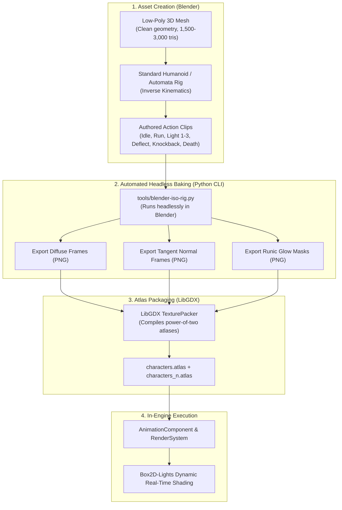

# GDD-08: Art Direction, Visual Hierarchy & Anti-Slop Asset Pipeline

## 1. Core Visual Pillars & Aesthetic DNA

**Die Old** rejects generic, noisy "AI-generated" art styles. AI image generation inherently fails in 2.5D isometric action games due to perspective drift, texture muddiness, inconsistent lighting, and an inability to maintain coherent frame-by-frame animation.

Instead, *Die Old* adopts a **Dark Industrial Alchemical Gothic** aesthetic, combining the sharp silhouettes and high-contrast readability of *Hades* with the mechanical grit and atmospheric depth of *Death's Door* and *Dead Cells*.

```
+-----------------------------------------------------------------------------------+
|                                 VISUAL PILLARS                                    |
+-----------------------------------------------------------------------------------+
| 1. Silhouette Readability | Characters & hazards stand out instantly against dark |
|                           | floors via crisp 1-pixel rim highlights.              |
| 2. Perspective Discipline | Strict 2:1 dimetric projection (30° pitch, 45° yaw).  |
|                           | Zero wandering vanishing points or warped tiles.      |
| 3. Palette Control        | Exact 32-color indexed palettes per biome.            |
|                           | Controlled contrast ramps; cool shadows, warm lights. |
| 4. Deterministic Motion   | Smooth, snappy 60 FPS animations with exact frame     |
|                           | counts and hitboxes (no AI morphing/jitter).          |
+-----------------------------------------------------------------------------------+
```

---

## 2. Why Generative 2D AI Fails & Our Anti-Slop Rulebook

| Problem Area | How Generic AI Fails ("AI Slop") | The *Die Old* Production Standard |
| :--- | :--- | :--- |
| **Perspective** | Inconsistent angles (e.g. 20° on tiles, 45° on props), breaking collision alignment. | **Strict 2:1 Dimetric Orthographic Camera**: Rendered from Blender with pitch $60^\circ$ ($30^\circ$ above plane) and yaw $45^\circ$. All floor tiles are exactly $64 \times 32$ px. |
| **Animation Coherence** | Limbs morph, weapon shapes change, and clothing textures warp between frames. | **3D Rigged Animation to 2D Sprite Baking** (The *Dead Cells* / *Hades* method): 3D low-poly models animated cleanly in Blender, baked to sprite sheets. Geometry never morphs. |
| **Lighting & Depth** | Flat, painted-in lighting that clashes with dynamic in-game torches and spell lights. | **Multi-Pass Texture Baking**: Every baked frame exports `diffuse.png` and a true tangent-space `normal.png`. LibGDX Box2D-Lights dynamically illuminates characters in real time! |
| **Visual Noise** | Over-rendered, mushy gradients with random unmotivated details that obscure combat. | **Crisp Cel-Shaded Shapes & Clear Value Separation**: Floors are kept in dark/mid-values ($15\text{--}35\%$ brightness); characters and hitsparks sit at $70\text{--}100\%$ brightness. |
| **Texel Density** | Mixed pixel sizes (e.g. 16px character next to a 512px noisy rock). | **Uniform Texel Density**: Exactly 32 pixels per world meter across all assets. |

---

## 3. The 3D-to-2D Production Pipeline (The *Dead Cells* Method)

To achieve handcrafted, premium-quality animations across 8 directions without spending years hand-drawing thousands of frames:



### Blender Baking Script Specification
The Python script located at `tools/blender-iso-rig.py` automates the entire process:
- Rotates the target model through 8 distinct angles ($0^\circ, 45^\circ, 90^\circ, 135^\circ, 180^\circ, 225^\circ, 270^\circ, 315^\circ$).
- Renders at native target resolution ($64 \times 64$ or $96 \times 96$ pixels per frame).
- Emits tangent normal passes using a specialized normal-baking shader.
- Runs via command line: `blender -b assets/models/player_youth.blend -P tools/blender-iso-rig.py`.
- **Time per full character (8 directions $\times$ 6 animations):** ~45 seconds.

---

## 4. Visual Metamorphosis: The Aging Character Models

Each life stage has a distinct, handcrafted 3D base mesh and texture scheme to ensure aging is immediately recognizable at a glance:

```
[Age 20-34: Youth]         [Age 35-54: Prime]         [Age 55-74: Elder]         [Age 75-80: Ascendant]
- Lean athletic build      - Broad martial stance     - Hunched elder mantle     - Levitating phantom
- Tight leather/linen      - Steel plates & leather   - Flowing ornate vestments - Translucent golden soul
- Dual steel daggers       - Tempered runic greatsword- Ancient runic catalyst   - Floating cosmic orbs
- Fast bounding stride     - Solid, measured steps    - Hovering mana glide      - Zero-friction levitation
```

---

## 5. Biome Visual Bibles & Color Discipline

Each of the game's four biomes follows a strict color palette ramp to guarantee distinct atmosphere and immediate readability:

### Biome 1: The Obsidian Foundry (Depths 1–2)
- **Mood:** Heavy, oppressive, suffocating heat, mechanical industry.
- **Palette Elements:**
  - *Floor / Foundations:* Deep basalt & obsidian `#121417`, `#1B1E23`, `#282D35`
  - *Walls & Machinery:* Cast iron & rusted bronze `#3B312B`, `#5E493E`, `#8B6D5A`
  - *Chrono / Energy:* Amber heat & molten slag `#FF6600`, `#FFAA00`, `#FFE57F`
  - *Accent:* Cooling blue soot `#4A607A`

### Biome 2: The Alchemical Aqueduct (Depths 3–4)
- **Mood:** Damp, toxic, decaying stonework, biometallurgical experimentation.
- **Palette Elements:**
  - *Floor / Stonework:* Wet slate & mossy cobblestone `#151B18`, `#202B25`, `#2E3D35`
  - *Fluids & Tanks:* Fluorescent vitriol & jade acid `#00E676`, `#00B0FF`, `#1DE9B6`
  - *Metals:* Corroded verdigris copper `#37474F`, `#455A64`, `#78909C`
  - *Accent:* Mutagen purple `#AA00FF`

### Biome 3: The Tesla Dynamo (Depths 5)
- **Mood:** Crackling high-voltage current, brass clockwork, blinding electrical arcs.
- **Palette Elements:**
  - *Floor / Tiles:* Polished brass & steel grating `#212121`, `#37474F`, `#546E7A`
  - *Current & Arcs:* Electric cyan & ozone blue `#00E5FF`, `#80D8FF`, `#FFFFFF`
  - *Chambers:* Burnished gold & coil copper `#B78103`, `#E0A926`, `#FFE082`

### Biome 4: The Grand Chrono-Orrery (Depths 6)
- **Mood:** Cosmic transcendence, clockwork celestial spheres, time distortion.
- **Palette Elements:**
  - *Void Background:* Deep stellar navy `#0A0E1A`, `#10182E`, `#1A234A`
  - *Constellations & Rings:* White-gold astral illumination `#FFF8E1`, `#FFD54F`, `#FFECB3`
  - *Time Tears:* Deep temporal violet `#4A148C`, `#7B1FA2`, `#E1BEE7`

---

## 6. Environmental Readability & Camera Cutaway Shading

A classic frustration in 2.5D isometric games is tall walls blocking the player's view of enemies and traps:
1. **Dithered Stencil Cutaway Shader:**
   - When the player or an enemy walks behind a foreground wall or archway, the wall does **not** vanish completely (which destroys immersion).
   - Instead, a circular alpha cutout with an **ordered $4 \times 4$ Bayer dithering matrix** dissolves the foreground structure, keeping the environment intact while providing 100% visibility of the combatant.
2. **Floor Contrast Contract:**
   - Floor tiles never exceed 35% luminosity.
   - Attack telegraphs (enemy red arcs, boss laser lines) are rendered at 100% luminosity in the additive blend pass, guaranteeing they are never missed.

---

## 7. VFX & Hitsparks: Juice, Physics & Shaders

VFX are **not** pre-rendered video clips or AI-generated GIFs. They are built natively using **mathematical shaders and particle physics**:
- **Deflect Spark Burst:** 24 individual directional spark particles with quadratic deceleration and 120ms lifetime.
- **Hitstop (Impact Freeze):** 4 frames (66ms) on normal hits; 8 frames (133ms) on successful parries; 12 frames (200ms) on guard-crushes. Box2D velocity freezes, creating visceral crunch.
- **Radial Chromatic Aberration Pulse:** A custom GLSL post-processing pass that splits RGB channels by 3–6 pixels for 80ms upon executing a perfect deflection.
- **Screen Shake (Directional Falloff):** Trauma-based screen shake ($trauma^2$) that decays linearly, aligned with the impact normal.

---

## 8. Sourcing & Production Phasing Strategy: Production Art First

| Stage | Focus | Source of Truth & Deliverables |
| :--- | :--- | :--- |
| **Phase 1: Production Art Foundation (Pre-Prototype)** | Visual Lock & Anti-Slop Asset Generation | • Low-poly 3D models rigged & animated in Blender (Player Youth + Foundry Hound).<br>• Automated headless 8-direction baking (`tools/blender-iso-rig.py`) with Diffuse, Normal, and Emission passes.<br>• Authored Biome 1 (Obsidian Foundry) 2:1 dimetric tileset ($64 \times 32$) with strict 32-color palette.<br>• Handcrafted VFX (sparks, slash arcs) & vector SVG HUD assets. |
| **Phase 2: Combat Engine on Real Art** | Real-Asset Playground & Physics | • LibGDX + Box2D 2.5D playground operating directly on Phase 1 production art (zero whitebox placeholders).<br>• Box2D-Lights dynamic lighting tuned to actual normal maps.<br>• 180° Deflection arc, wall-slams, and dithered stencil cutaways. |
| **Phase 3: Content Expansion** | Biomes 2–4 & Full Enemy Roster | • 3 Remaining Player Life Stages (Prime, Elder, Ascendant).<br>• 12 Automata enemy variants and 4 multi-phase Apex Bosses.<br>• Biomes 2–4 tilesets (Alchemical Aqueduct, Tesla Dynamo, Grand Chrono-Orrery). |

