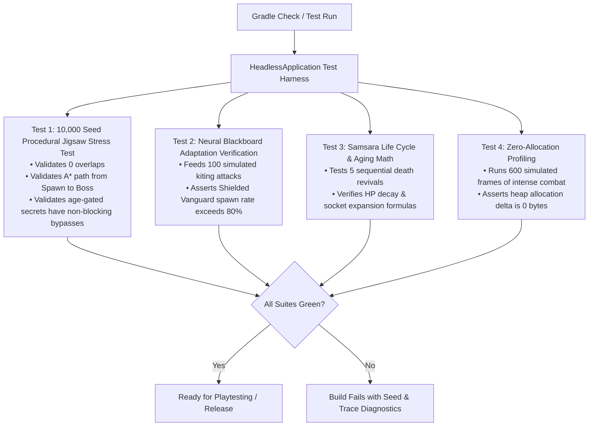

# QA-01: Quality Assurance & Performance Benchmarking Plan

## 1. Quality Objectives & Performance Budgets

To deliver a commercial-grade, stutter-free action experience, *Chronos-Echo* adheres to rigid engineering performance budgets:

| Metric | Target Budget | Hard Failure Limit | Measurement Tool |
| :--- | :--- | :--- | :--- |
| **Target Frame Rate** | **60 FPS** | $< 58 \text{ FPS}$ | LibGDX `FPSLogger` |
| **Frame Time Budget** | **16.6ms** | $> 16.6\text{ms}$ | VisualVM / JProfiler |
| **Garbage Collection (GC) Pauses** | **0ms during combat** | Any GC pause $> 2\text{ms}$ | GC Logging (`-Xlog:gc*`) |
| **Procedural Generation Time** | $< 250\text{ms}$ (Headless) | $> 500\text{ms}$ | JUnit Benchmark Suite |
| **Soft-Lock Rate** | **0.00%** | $> 0 \text{ in 10,000 seeds}$ | Headless A* Path Validator |

---

## 2. Automated Headless Test Suite

Because LibGDX allows running in a headless environment without an active OpenGL window (`HeadlessApplication`), we execute automated regression suites before any production build:

---

## 3. Zero-Allocation Invariant & Memory Discipline

1. **Object Pooling:**
   - All high-frequency transient objects (`Vector2`, `Vector3`, `RayCastCallback`, `DamageEvent`) must be acquired from a LibGDX `Pool<T>` and freed after use.
2. **Collection Hygiene:**
   - Never use standard Java `java.util.ArrayList` or `HashMap` in the render or physics loop due to boxing and iterator garbage. Use LibGDX's high-performance primitives: `Array<T>`, `ObjectMap<K, V>`, `IntMap<V>`, `ObjectSet<T>`.
3. **Lambda / Stream Prohibition:**
   - Java Streams (`list.stream().filter(...).map(...)`) and allocating lambdas are strictly forbidden inside `EntitySystem.update()` to prevent hidden heap allocations.
