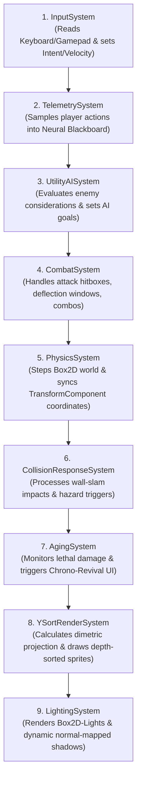

# TDD-02: Entity Component System (Ashley ECS) Specification

## 1. Architectural Rules for ECS
1. **Components are Pure Data:** Components must contain public fields or getters/setters with zero game logic, methods, or internal state manipulation.
2. **Systems are Pure Logic:** Systems process sets of entities filtered by Ashley `Family` matchers.
3. **Deterministic System Priority:** Every system is assigned an explicit integer priority to guarantee execution order per frame.

---

## 2. Complete Component Catalog

```mermaid
classDiagram
    class TransformComponent {
        +Vector3 position (x, y, z)
        +Vector2 velocity
        +float rotationDegrees
        +float scale
    }
    class PhysicsBodyComponent {
        +Body box2dBody
        +short categoryBits
        +short maskBits
    }
    class HealthComponent {
        +float currentHp
        +float maxHp
        +float poise
        +float maxPoise
        +boolean isVulnerable
    }
    class AgingComponent {
        +int currentAge
        +AgeStage stage
        +int deathCount
        +int socketCapacity
    }
    class DeflectionComponent {
        +float activeTimer
        +float windowDuration (0.12s)
        +float radius
        +boolean isDeflecting
    }
    class RunicMatrixComponent {
        +List~Rune~ socketedRunes
        +float cooldownRemaining
    }
    class TelemetrySubjectComponent {
        +RollingMetrics metrics
    }
    class UtilityAIComponent {
        +AIArchetype archetype
        +float thinkTimer
        +AIAction currentAction
    }
```

---

## 3. System Execution Order & Priorities

Each frame, the Ashley `Engine.update(deltaTime)` executes systems in this strict sequence:

### System Priority Table:

| Priority | System Name | Ashley Family Filter | Primary Responsibility |
| :--- | :--- | :--- | :--- |
| **10** | `InputSystem` | `PlayerComponent, TransformComponent` | Translates raw hardware input into movement and attack vectors. |
| **20** | `TelemetrySystem` | `PlayerComponent, TelemetrySubjectComponent` | Aggregates 60-second rolling combat data into the shared `Blackboard`. |
| **30** | `UtilityAISystem` | `UtilityAIComponent, PhysicsBodyComponent` | Re-evaluates behavior scores based on player threat profiles. |
| **40** | `CombatSystem` | `CombatComponent, HealthComponent` | Handles active frames, damage resolution, and poise breaks. |
| **50** | `PhysicsSystem` | `PhysicsBodyComponent, TransformComponent` | Runs Box2D accumulator step and updates entity transforms. |
| **60** | `WallSlamSystem` | `PhysicsBodyComponent, HealthComponent` | Resolves momentum loss against walls into crushing damage. |
| **70** | `AgingSystem` | `PlayerComponent, AgingComponent` | Intercepts zero-HP events and initiates the Samsara lifecycle. |
| **80** | `YSortRenderSystem` | `TransformComponent, TextureComponent` | Sorts entities by base $Y$-value and renders via `SpriteBatch`. |
| **90** | `LightingSystem` | All Light / Shadow entities | Draws dynamic ambient occlusion, shadows, and point lights. |
