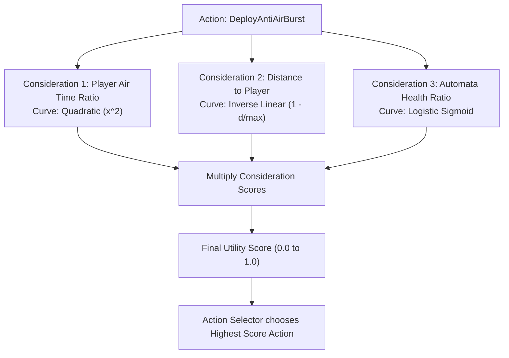

# TDD-03: AI Utility Engine & Neural Blackboard Implementation

## 1. Mathematical Foundation of the Utility AI

Unlike rigid finite state machines, a **Utility AI** evaluates all possible behaviors continuously using mathematical **Consideration Response Curves** (0.0 to 1.0) and selects the action with the highest composite utility score:

$$\text{FinalUtility} = \prod_{i=1}^{n} \text{Score}(C_i) \times \text{Weight}$$



---

## 2. Java Implementation of Consideration Curves

```java
package com.chronos.echo.ai.utility;

public final class UtilityCurves {
    // Linear clamp
    public static float linear(float value, float min, float max) {
        if (value <= min) return 0.0f;
        if (value >= max) return 1.0f;
        return (value - min) / (max - min);
    }

    // Quadratic curve (sharp escalation when player over-relies on a tactic)
    public static float quadratic(float normalizedValue) {
        float clamped = Math.max(0.0f, Math.min(1.0f, normalizedValue));
        return clamped * clamped;
    }

    // Logistic / Sigmoid curve for smooth threshold transitions
    public static float logistic(float value, float midpoint, float steepness) {
        return (float) (1.0 / (1.0 + Math.exp(-steepness * (value - midpoint))));
    }
}
```

---

## 3. The Neural Blackboard Singleton

The `NeuralBlackboard` acts as the shared sensory cortex of the dungeon. It maintains rolling circular buffers for high-frequency player actions:

```java
package com.chronos.echo.ai.blackboard;

public class NeuralBlackboard {
    private static final NeuralBlackboard INSTANCE = new NeuralBlackboard();
    
    // Rolling 60-second telemetry windows
    private final RollingSampleBuffer rangedAttacks = new RollingSampleBuffer(60);
    private final RollingSampleBuffer meleeAttacks = new RollingSampleBuffer(60);
    private final RollingSampleBuffer airborneSeconds = new RollingSampleBuffer(60);
    private final RollingSampleBuffer deflectSuccesses = new RollingSampleBuffer(60);
    
    // Adaptive Threat Level (1 to 5)
    private int currentThreatLevel = 1;
    
    public static NeuralBlackboard getInstance() {
        return INSTANCE;
    }

    public synchronized void recordPlayerAttack(boolean isRanged, ElementType element) {
        if (isRanged) rangedAttacks.recordSuccess();
        else meleeAttacks.recordSuccess();
    }

    public float getRangedAttackProportion() {
        int total = rangedAttacks.getTotal() + meleeAttacks.getTotal();
        if (total == 0) return 0.5f;
        return (float) rangedAttacks.getTotal() / total;
    }

    public float getAirborneBias() {
        return airborneSeconds.getAverageRate(); // 0.0 to 1.0
    }

    // Called on Samsara Revival (Amnesia Purge)
    public synchronized void purgeMemory() {
        rangedAttacks.clear();
        meleeAttacks.clear();
        airborneSeconds.clear();
        deflectSuccesses.clear();
        currentThreatLevel = 1;
    }
}
```

---

## 4. Evaluated Enemy Actions

| Behavior Class | Purpose | Primary Considerations |
| :--- | :--- | :--- |
| `DeployAntiAirBurstAction` | Fires upward flak charges | `AirborneBias > 0.35` and `DistanceToPlayer < 7m` |
| `RaiseKineticAegisAction` | Raises directional shield | `RangedAttackProportion > 0.60` and `PlayerFacingDirectly` |
| `StalkerFlankAmbushAction` | Cloaks and teleports behind | `PlayerEngagementDistance > 5m` and `PlayerInActiveCombo` |
| `GroundShockwaveAction` | Emits unparriable ring | `DeflectSuccessRate > 0.55` and `PlayerDistance < 3m` |
