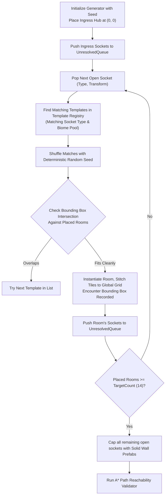

# TDD-04: Procedural Level Generator Pipeline

## 1. Jigsaw Socket Matching Algorithm

Level generation operates as a recursive, depth-bounded socket expansion solver:



---

## 2. Bounding Box & Alignment Math

Rooms are aligned by calculating the translation offset between the parent socket and child socket:

$$\vec{P}_{\text{room}} = \vec{P}_{\text{parentSocket}} - \vec{R}_{\text{childSocket}}$$

```java
package com.chronos.echo.procedural;

import com.badlogic.gdx.math.Rectangle;
import com.badlogic.gdx.math.Vector2;

public class SocketConnector {
    public static Vector2 calculateRoomPlacement(
        Vector2 parentSocketWorldPos, 
        Vector2 childSocketLocalPos
    ) {
        return new Vector2(
            parentSocketWorldPos.x - childSocketLocalPos.x,
            parentSocketWorldPos.y - childSocketLocalPos.y
        );
    }

    public static boolean checkOverlap(
        Rectangle candidateBounds, 
        Iterable<Rectangle> placedBounds
    ) {
        for (Rectangle existing : placedBounds) {
            // Include 1-tile safety margin to prevent overlapping walls
            if (candidateBounds.overlaps(existing)) {
                return true;
            }
        }
        return false;
    }
}
```

---

## 3. Pathfinding Connectivity Validator (Guaranteed No Soft-Locks)

Before a generated level is presented to the player, a headless **Grid-Based A* Reachability Test** executes:
1. Identifies the coordinates of `PlayerSpawn` and `BossSanctumGate`.
2. Verifies that at least one uninterrupted path exists through traversable floor tiles.
3. If an age-gated passage is encountered, verifies that a non-age-gated main arterial route exists as an alternative.
4. If validation fails, the generator discards the layout and retries with `seed + 1` (max 3 retries before logging an alert).
