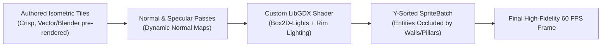

# TDD-05: Rendering Engine & Art Pipeline Specification (Anti-Slop Standards)

## 1. Visual Style & 2.5D Depth Target

The visual target is a **clean, stylized 2.5D isometric aesthetic** inspired by *Hades*, *Death's Door*, and *Transistor*:
- **Camera Projection:** Dimetric 2:1 isometric ($30^\circ$ elevation angle).
- **Depth Cues:** Dynamic drop shadows, normal-mapped surface relief, distinct elevation ledges, and atmospheric depth haze.
- **Color Palette:** High-contrast, intentional 32-color palette per biome (e.g., slate-gray obsidian foundations, vibrant cyan chrono-energy, deep amber foundry flames, and jade alchemical conduits).



---

## 2. Preventing "AI Slop" & Generic Artifacts (Asset Quality Contract)

Many modern indie and AI-assisted games fail because they generate noisy, inconsistent textures that look muddy, have mismatched perspective angles, blurred edges, and conflicting pixel scales. 

**Chronos-Echo enforces a strict Anti-Slop Asset Standard:**

| Quality Metric | Forbidden ("AI Slop" Smell) | Mandatory Standard for Chronos-Echo |
| :--- | :--- | :--- |
| **Perspective Alignment** | Warped angles, drifting horizon lines, non-isometric geometry | Strict $30^\circ$ dimetric projection grid. All floor tiles match an exact 2:1 width-to-height ratio (e.g., $64 \times 32$ pixels). |
| **Silhouette & Readability** | Muddy clutter, noisy gradients, indistinct outlines | Bold, readable silhouettes with a 1-pixel dark rim or cel-outline. Characters must be instantly identifiable against dark floors. |
| **Resolution Consistency (Texel Density)** | Mixed pixel resolutions (some items 16px, others 512px) | Standardized texel density: 1 world meter = 32 pixels. No pixel stretching or mismatched scales. |
| **Palette Discipline** | Random muddy color blends and artifacted halos | Palette indexing with strict color ramps. Shadows tinted cool navy/purple; lights tinted warm amber or electric cyan. |
| **Asset Origin Pipeline** | Uncurated raw diffusion generation | Hand-crafted SVG vectors OR 3D low-poly models rendered in Blender with orthogonal isometric cameras to produce clean sprite sheets. |

---

## 3. The Asset Generation Pipeline (Blender to LibGDX)

To achieve clean, professional, non-slop art without needing a massive team of hand-drawn animators:
1. **Low-Poly 3D Modeling (Blender):**
   - Characters, automata, and architectural pillars are modeled in clean, minimalist low-poly geometry.
   - Flat/cel-shading with crisp silhouette edges.
2. **Automated Isometric Sprite Baking:**
   - A standardized Blender script renders 8-directional isometric animations at $30^\circ$ camera pitch.
   - Outputs:
     1. `diffuse.png` (Base colors).
     2. `normal.png` (Surface normal vectors for dynamic 2D lighting).
3. **LibGDX Texture Packer (`TexturePacker`):**
   - Compiles individual frame cuts into optimal, power-of-two texture atlases (`.atlas`) with zero runtime texture swapping overhead.

---

## 4. Dynamic Lighting & Shading Engine

LibGDX integrates **Box2D-Lights** to achieve dynamic atmospheric lighting:
- **Point Lights:** Attached to chrono-runes, glowing eyes of automata, and torches.
- **Directional Sunlight / Ambient Radiance:** Casts realistic shadows off walls and obstacles based on Box2D collision geometry.
- **Post-Processing Shaders:**
  - *Chrono-Aberration:* When parrying or aging, a subtle chromatic aberration and radial blur pulses across the screen for 100ms.
  - *Sepia Memory Wash:* During the Amnesia Purge selection screen, the world desaturates into an ancient parchment wash.
  - *Dithered Stencil Cutaway:* Cuts an alpha hole with ordered Bayer dithering when player/enemies walk behind foreground walls.

---

## 5. Asset Production Strategy: Production Art First (Zero Placeholder Policy)

To eliminate "AI slop" and ensure that all gameplay, combat hitboxes, Box2D-Lights, and Y-sorting are calibrated against the real visual targets, **production art creation precedes gameplay prototyping**:

| Asset Category | Phase 1: Production Art Foundation (Pre-Prototype) | Phase 2: Content Scaling (Full Game) |
| :--- | :--- | :--- |
| **Characters & Automata** | Low-poly 3D models rigged in Blender (Player Youth + Foundry Hound), keyframed, and headlessly baked into 8-direction sprite sheets (`diffuse` + `normal` maps). | Full 4 Life Stage player variations (Prime, Elder, Ascendant) + complete 12-enemy and 4-boss roster. |
| **Environment Tilesets** | Authored Biome 1 (Obsidian Foundry) 2:1 dimetric tileset ($64 \times 32$ floor, walls, columns, slag hazards) with strict 32-color ramp and matching tangent normal maps. | Biomes 2–4 tilesets (Alchemical Aqueduct, Tesla Dynamo, Grand Chrono-Orrery) and animated hazard tiles. |
| **VFX & Hitsparks** | Handcrafted directional deflect sparks, slash arcs, dust puffs, and GLSL impact/cutaway shaders. | Runic elemental reaction shaders (Thermal Shock, Conductive Surge, Cryo-Lock) and boss laser telegraphs. |
| **User Interface (HUD)** | Vector SVG master assets (Chrono-Pendant life dial, Runic sockets, Poise/Health bars) packed into high-res atlas. | Full Sanctuary archive menus, telemetry screens, and boss intro placards. |
| **SFX & Foley** | Sonniss GDC Archive (100% CC0 commercial-grade) for high-transient metallic impacts, parry clangs, and steam vents. | Bespoke foley recordings and 4-stem vertical adaptive music arrangements. |


---

## 6. Headless Blender Isometric Baking Script (`tools/blender-iso-rig.py`)

A standardized Python automation script renders 8-directional isometric animations headlessly inside Blender:

```python
# tools/blender-iso-rig.py
import bpy
import math

# 2:1 Dimetric Camera Configuration:
# Camera Pitch: 60.0° (elevation 30°), Yaw: 45.0°
CAMERA_ROTATIONS = [0, 45, 90, 135, 180, 225, 270, 315] # 8 Directions

def setup_iso_camera():
    cam = bpy.data.objects['Camera']
    cam.data.type = 'ORTHO'
    cam.data.ortho_scale = 3.5
    cam.rotation_euler = (math.radians(60), 0, math.radians(45))

def render_8_directions(output_dir, action_name):
    # Rotates scene empty parented to character to render all 8 directional angles
    rig = bpy.data.objects['CharacterRig']
    for i, angle in enumerate(CAMERA_ROTATIONS):
        rig.rotation_euler[2] = math.radians(angle)
        bpy.context.scene.render.filepath = f"{output_dir}/{action_name}_dir{i}_"
        bpy.ops.render.render(animation=True)
```

Running `blender -b character.blend -P tools/blender-iso-rig.py` automatically bakes all 8 angles and normal maps in **under 45 seconds**, completely eliminating the need for expensive hand-drawn 2D animation teams!
